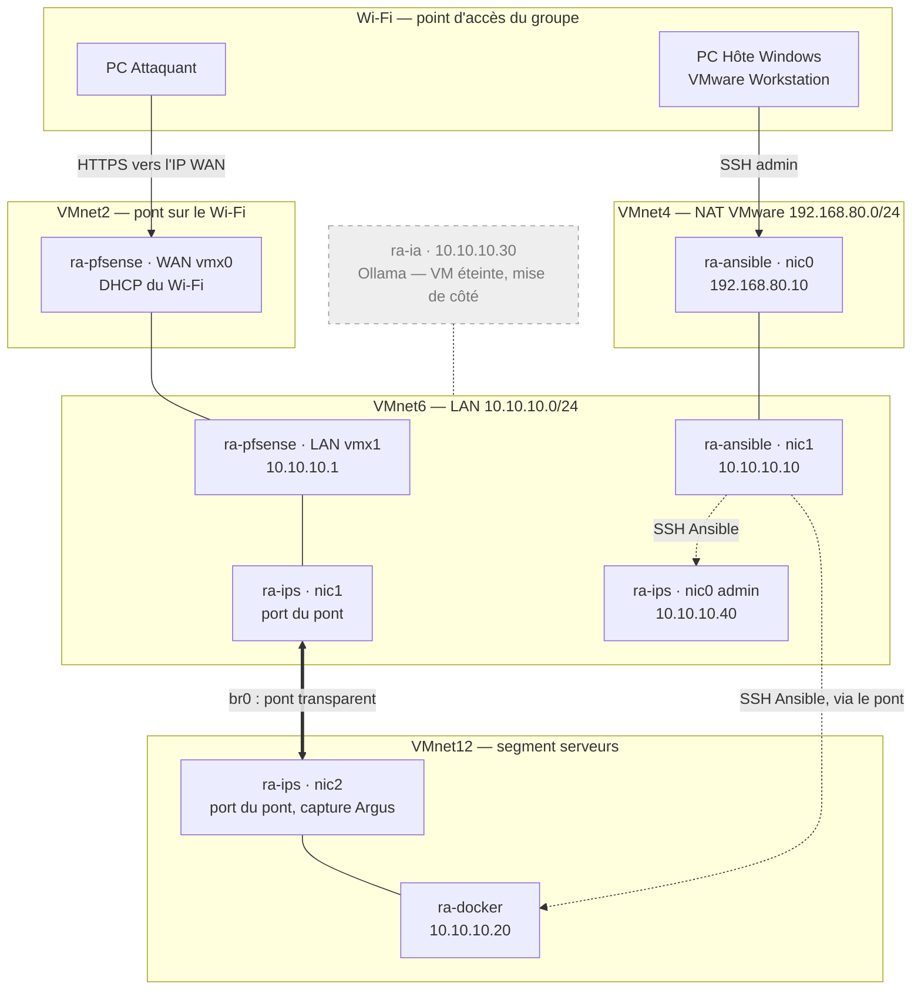
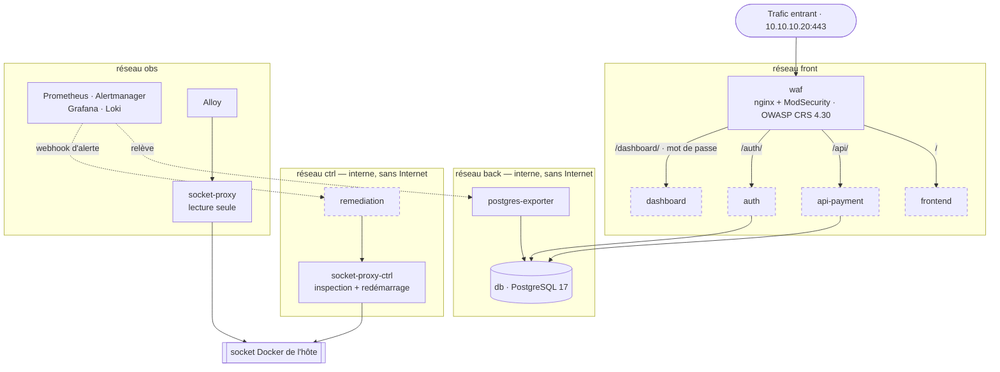
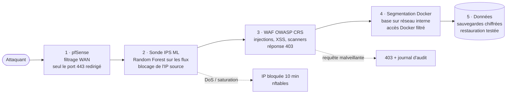
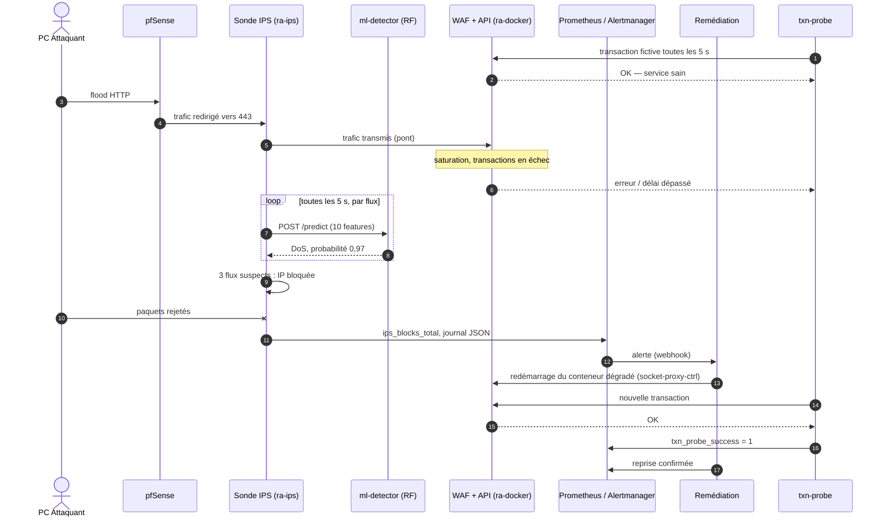
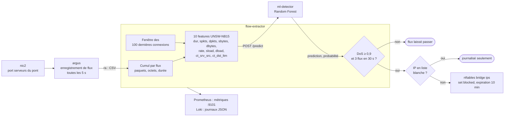
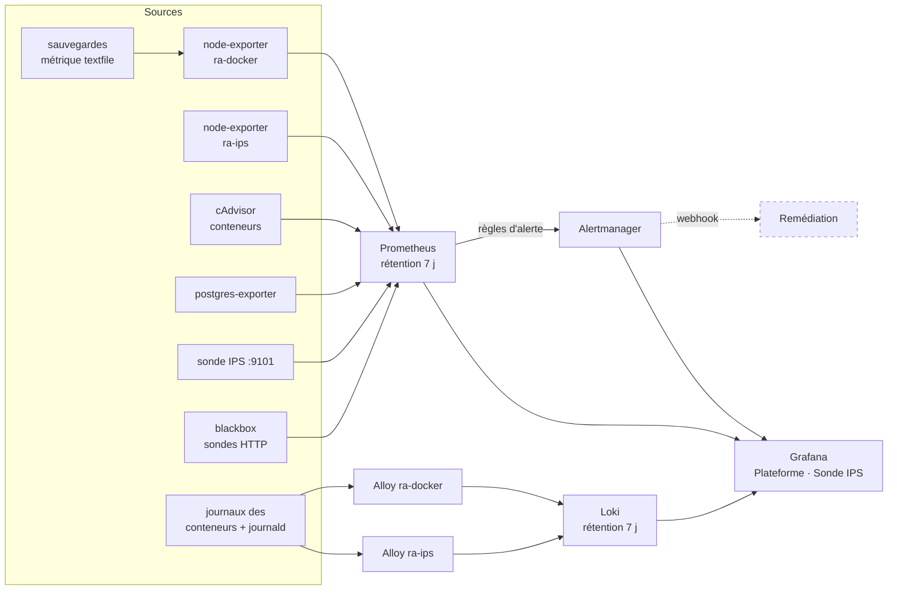
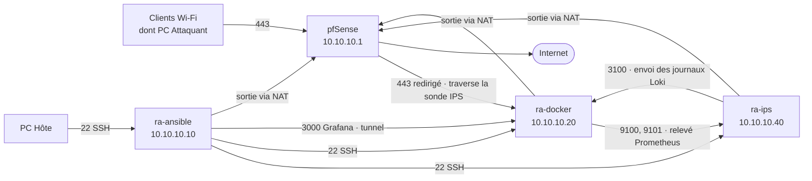
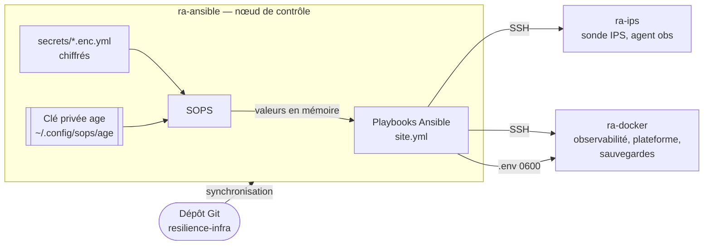
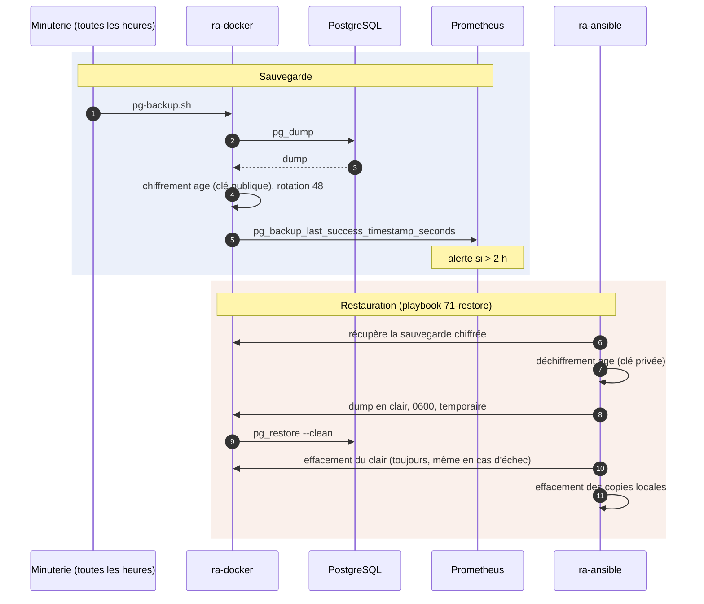

# Schémas — RESILIENCE-ALPHA

Légende commune : les éléments en **pointillés** sont fournis par l'équipe DEV et pas encore intégrés.

Versions images (pour le dossier et la présentation) : [docs/schemas/](schemas/).

1. [Architecture technique](#1-architecture-technique)
2. [Services et réseaux Docker de la plateforme](#2-services-et-réseaux-docker-de-la-plateforme)
3. [Chaîne de défense en profondeur](#3-chaîne-de-défense-en-profondeur)
4. [Scénario d'incident : détection et reprise automatique](#4-scénario-dincident--détection-et-reprise-automatique)
5. [Pipeline de la sonde IPS](#5-pipeline-de-la-sonde-ips)
6. [Observabilité : métriques, journaux, alertes](#6-observabilité--métriques-journaux-alertes)
7. [Flux réseau autorisés](#7-flux-réseau-autorisés)
8. [Déploiement et gestion des secrets](#8-déploiement-et-gestion-des-secrets)
9. [Sauvegarde et restauration (PRA)](#9-sauvegarde-et-restauration-pra)

---

## 1. Architecture technique

Machines virtuelles VMware Workstation sur le PC hôte, réseaux virtuels et plan d'adressage.

| VM | Rôle | RAM / vCPU |
|---|---|---|
| `ra-pfsense` | Pare-feu, NAT, segmentation | 2 Go / 2 |
| `ra-ansible` | Nœud de contrôle (Ansible, SOPS, clé age) | 2 Go / 1 |
| `ra-ips` | Sonde IPS en coupure | 2 Go / 2 |
| `ra-docker` | Plateforme conteneurisée | 8 Go / 6 |

---

## 2. Services et réseaux Docker de la plateforme

Sur `ra-docker`. Les réseaux `back` et `ctrl` sont internes : aucun accès à Internet.

---

## 3. Chaîne de défense en profondeur

Chaque couche traite une menace différente ; une attaque doit les traverser toutes.

| Couche | Menace traitée | Mécanisme |
|---|---|---|
| pfSense | Exposition inutile | Seul le 443 est redirigé vers le WAF |
| Sonde IPS | Déni de service, saturation | Classification ML des flux, blocage nftables avec expiration |
| WAF | Attaques applicatives | Règles OWASP CRS, score d'anomalie |
| Segmentation | Rebond après compromission | Réseaux internes, proxys Docker à droits minimaux, pare-feu des hôtes |
| Données | Perte ou corruption | Sauvegarde chiffrée toutes les heures, PRA testé |

---

## 4. Scénario d'incident : détection et reprise automatique

Déroulé visé pour la démonstration (aucune intervention humaine).

---

## 5. Pipeline de la sonde IPS

Fonctionnement interne de `ra-ips`.

---

## 6. Observabilité : métriques, journaux, alertes

| Alerte | Déclencheur |
|---|---|
| CibleInjoignable | une cible ne répond plus depuis 1 min |
| CpuSature | CPU d'un hôte > 90 % pendant 2 min |
| SondeHttpEnEchec | sonde HTTP en échec |
| IpsDosDetecte | flux classés DoS par le modèle |
| IpsIpBloquee | IP bloquée par la sonde |
| IpsModeleInjoignable | `/predict` ne répond plus |
| SauvegardeBaseAncienne | dernière sauvegarde > 2 h |

---

## 7. Flux réseau autorisés

Tout flux absent de ce schéma est refusé par les pare-feu des hôtes.

| Règle | Où |
|---|---|
| SSH accepté uniquement depuis `ra-ansible` | pare-feu `hostfw` de `ra-docker` et `ra-ips` |
| Grafana (3000) : `ra-ansible` uniquement | chaîne `DOCKER-USER` de `ra-docker` |
| Loki (3100) : `ra-ips` uniquement | chaîne `DOCKER-USER` de `ra-docker` |
| Métriques de `ra-ips` : `ra-docker` uniquement | pare-feu `hostfw` de `ra-ips` |
| WAN pfSense : tout bloqué sauf 443 | pfSense (redirection à activer le jour de la démo) |

---

## 8. Déploiement et gestion des secrets

Infrastructure décrite en code, secrets chiffrés dans le dépôt.

| Playbook | Rôle |
|---|---|
| `00-control` | outils SOPS et age |
| `10-base` | socle commun |
| `15-hardening` | pare-feu, SSH |
| `20-docker` | moteur Docker |
| `40-ips` | sonde IPS |
| `50-observability` | supervision |
| `60-platform` | WAF, base, accès Docker de la remédiation |
| `70-backup` / `71-restore` | sauvegardes / PRA |

Relancer `site.yml` sur l'infrastructure en place ne modifie rien : le déploiement est reproductible.

---

## 9. Sauvegarde et restauration (PRA)

`ra-docker` chiffre avec la clé **publique** : il ne peut pas relire ses propres sauvegardes. Seul `ra-ansible` peut déchiffrer.

